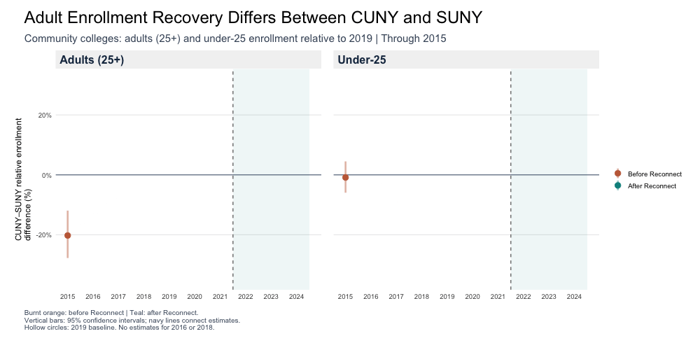

# Introduction

In Fall 2022, CUNY launched [CUNY Reconnect](https://www.cuny.edu/news/council-speaker-adams-and-cuny-chancellor-matos-rodriguez-launch-program-to-re-engage-thousands-of-former-working-age-students-towards-gaining-degrees-that-increase-earning-potential/) to help former students return to college and complete their degrees. While the program aimed to support enrollment recovery, an important question remains: did adult enrollment recover more strongly at CUNY than at other public colleges in New York?

Our team project addresses the following overarching question (OQ):

**How have major disruptions since 2015 coincided with changes in CUNY enrollment, and which student populations and institutions have experienced the greatest declines and recoveries?**

My individual analysis focuses on adult learners aged 25 and older, who may face additional challenges when returning to college, such as work, financial and family responsibilities.

## Specific Research Question

::: {.callout-note icon=false}
**SQ3: Institutional Recovery Programs**

After CUNY Reconnect launched in Fall 2022, did adult (25+) undergraduate enrollment at CUNY community colleges grow faster than younger enrollment — and faster than at SUNY community colleges, which had no equivalent program until Fall 2025?
:::

SUNY provides a useful comparison because both university systems operate within New York State and experienced the pandemic, although their local conditions may differ. Community colleges are the primary focus, while four-year colleges provide an additional comparison.

This analysis contributes to our overarching research question by examining whether CUNY's institutional response coincided with stronger adult enrollment recovery. Using enrollment trends, event-study models and robustness checks, I examine whether the evidence supports this expectation without assuming that Reconnect caused the observed changes.

```{r}
#| label: sq3-setup
#| include: false
source("03_data_age.R")
library(scales)
library(gt)

# Program timeline: CUNY Comeback (2021), CUNY Reconnect (2022),
# free community college for adults at CUNY and SUNY (2025)
PROGRAMS <- tibble(
  year  = c(2021, 2022, 2025),
  label = c("Comeback", "Reconnect", "Free CC (CUNY + SUNY)")
)

SYS_COLORS <- c(CUNY = "#1f5aa6", SUNY = "#c8781e")
```

### Exploratory analysis

### DELETE THIS IF NOT REQUIRED

```{r}
#| label: fig-sq3-adult-share-communityVS4-yearcolleges
#| fig-width: 13
#| fig-height: 6
#| code-fold: true
#| message: false

# Load SQ3 data and colors if they are not in memory yet
if (!exists("AGE_PANEL"))  source("03_data_age.R")
if (!exists("SYS_COLORS")) SYS_COLORS <- c(CUNY = "#1f5aa6", SUNY = "#c8781e")

# Program dates (context lines, not tested effects); short labels for narrow panels
EVENT_LINES_2 <- tibble(
  year  = c(2021, 2022, 2025),
  label = c("Comeback", "Reconnect", "Free CC"),
  hjust = c(1.05, -0.05, 1.05)
)

# Share of adults (25+) per system x sector x year
SHARE_SECTORS <- AGE_PANEL |>
  group_by(system, sector, year) |>
  summarize(share  = sum(age25plus) / sum(total),
            source = first(source),
            .groups = "drop") |>
  complete(system, sector, year = 2015:2025) |>   # missing years -> NA -> line breaks
  mutate(source = if_else(str_detect(coalesce(source, ""), "Data Book"),
                          "CUNY Data Book (spliced)", "IPEDS"))

p_sectors <- ggplot(SHARE_SECTORS, aes(year, share, color = system)) +
  geom_vline(data = EVENT_LINES_2, aes(xintercept = year),
             linetype = "dotted", color = "grey45") +
  geom_text(data = EVENT_LINES_2,
            aes(x = year, y = Inf, label = label, hjust = hjust),
            inherit.aes = FALSE, vjust = 1.6, size = 3.2, color = "grey30") +
  geom_line(linewidth = 1.1, na.rm = TRUE) +
  geom_point(aes(shape = source), size = 2.8, stroke = 1.2,
             fill = "white", na.rm = TRUE) +
  scale_shape_manual(values = c("IPEDS" = 16, "CUNY Data Book (spliced)" = 21),
                     name = NULL) +
  scale_color_manual(values = SYS_COLORS, name = NULL) +
  scale_y_continuous(labels = scales::percent_format(accuracy = 1),
                     expand = expansion(mult = c(0.05, 0.18))) +
  scale_x_continuous(breaks = seq(2015, 2025, 2)) +
  facet_wrap(~ sector,
             labeller = as_labeller(c(Community   = "Community colleges",
                                      `Four-year` = "Four-year colleges"))) +
  labs(title = "Adult Enrollment Shares Differed Between CUNY and SUNY",
  subtitle = "Undergraduates aged 25+, by college sector, Fall 2015–2025",
       x = NULL, y = "Share of adults (25+)",
       caption  = paste0(
         "Sources: IPEDS Fall Enrollment Part B; CUNY Student Data Book ",
         "(2022, 2024, 2025, spliced to IPEDS using 2023 ratios).\n",
         "Gaps = years not reported or < 90% of colleges reporting. ",
         "SUNY 2025 not available (IPEDS not yet released). Dotted lines mark dates, not effects. ",
         "Free CC = free community college for ages 25–55 (CUNY + SUNY).")) +
    theme_minimal(base_size = 13) +
  theme(
    legend.position = "bottom",
    panel.grid.minor = element_blank(),
    panel.spacing = unit(2, "lines"),
    plot.title.position = "plot",
    plot.title = element_text(face = "bold", size = 17),
    plot.subtitle = element_text(size = 11, color = "#64748B"),
    plot.caption = element_text(hjust = 0, color = "grey40", size = 9),
    strip.text = element_text(face = "bold", size = 13)
  )
p_sectors

# Quick check: the numbers behind the chart
SHARE_SECTORS |>
  filter(!is.na(share), year %in% c(2019, 2021, 2023, 2024, 2025)) |>
  mutate(share = scales::percent(share, accuracy = 0.1)) |>
  select(sector, system, year, share) |>
  pivot_wider(names_from = year, values_from = share) |>
  print()

dir.create("figures", showWarnings = FALSE)
ggsave("figures/sq3_adult_share_sectors.png", p_sectors,
       width = 13, height = 6, dpi = 300, bg = "white")
```


### Age counts
### THIS code is required to build fig-sq3-age-counts-full
```{r}
#| label: fig-sq3-age-counts
#| fig-width: 12
#| fig-height: 6
#| include: false
#| code-fold: true
#| message: false

# Load SQ3 data if it is not in memory yet
if (!exists("AGE_PANEL")) source("03_data_age.R")

# Program dates (context lines, not tested effects)
EVENT_LINES_3 <- tibble(
  system = c("CUNY",     "CUNY",      "CUNY",    "SUNY"),
  year   = c(2021,       2022,        2025,      2025),
  label  = c("Comeback", "Reconnect", "Free CC", "Free CC"),
  hjust  = c(1.05,       -0.05,       1.05,      1.05)
)

# Community colleges: adults vs under 25, counts indexed to Fall 2019 = 100
COUNT_DATA <- AGE_PANEL |>
  filter(sector == "Community") |>
  group_by(system, year) |>
  summarize(n_colleges = n(),
            age25plus  = sum(age25plus),
            under25    = sum(under25),
            source     = first(source),
            .groups = "drop") |>
  group_by(system) |>
  filter(n_colleges == max(n_colleges)) |>   # only years where ALL colleges reported
  ungroup() |>
  pivot_longer(c(age25plus, under25), names_to = "group", values_to = "students") |>
  group_by(system, group) |>
  mutate(index = students / students[year == 2019] * 100) |>
  ungroup() |>
  complete(system, group, year = 2015:2025) |>   # missing years -> line breaks
  mutate(group  = recode(group, age25plus = "Adults (25+)", under25 = "Under 25"),
         source = if_else(str_detect(coalesce(source, ""), "Data Book"),
                          "CUNY Data Book (spliced)", "IPEDS"))

p_counts <- ggplot(COUNT_DATA, aes(year, index, color = group)) +
  geom_hline(yintercept = 100, color = "grey70") +
  geom_vline(data = EVENT_LINES_3, aes(xintercept = year),
             linetype = "dotted", color = "grey45") +
  geom_text(data = EVENT_LINES_3,
            aes(x = year, y = Inf, label = label, hjust = hjust),
            inherit.aes = FALSE, vjust = 1.6, size = 3.4, color = "grey30") +
  geom_line(linewidth = 1.1, na.rm = TRUE) +
  geom_point(aes(shape = source), size = 2.8, stroke = 1.2,
             fill = "white", na.rm = TRUE) +
  scale_color_manual(values = c("Adults (25+)" = "#7b3294", "Under 25" = "#008837"),
                     name = NULL) +
  scale_shape_manual(values = c("IPEDS" = 16, "CUNY Data Book (spliced)" = 17),
  name = NULL) +
  scale_y_continuous(expand = expansion(mult = c(0.05, 0.18))) +
  scale_x_continuous(breaks = seq(2015, 2025, 2)) +
  facet_wrap(~ system,
             labeller = as_labeller(c(CUNY = "CUNY community colleges",
                                      SUNY = "SUNY community colleges"))) +
  labs(title    = "Adult Enrollment Recovered More Slowly Than Younger Enrollment at Both CUNY and SUNY",
       subtitle = "Undergraduate enrollment by age group, indexed to Fall 2019 = 100, 2015–2025.",
       x = NULL, y = "Index (Fall 2019 = 100)",
       caption  = paste0(
         "Sources: IPEDS Fall Enrollment Part B; CUNY Student Data Book ",
         "(2022, 2024, 2025, spliced to IPEDS using 2023 ratios).\n",
         "Only years where every community college in the system reported age. ",
         "SUNY 2025 not available (IPEDS not yet released). Dotted lines mark dates, not effects. ",
         "Free CC = free community college for ages 25–55 (CUNY + SUNY).")) +
  theme_minimal(base_size = 13) +
  theme(legend.position  = "bottom",
        panel.grid.minor = element_blank(),
        panel.spacing    = unit(2, "lines"),
        plot.caption     = element_text(hjust = 0, color = "grey40", size = 9),
        strip.text = element_text(
        face = "bold",
        hjust = 0,
        size = 13,
        color = "#17324D",
        margin = margin(6, 6, 6, 6)
        ),
        strip.background = element_rect(
        fill = "#F3F4F6",
        color = NA
        )
      )

  p_counts

# Numbers behind the chart
COUNT_DATA |>
  filter(!is.na(index), year %in% c(2019, 2021, 2022, 2023, 2024, 2025)) |>
  mutate(index = round(index, 1)) |>
  select(system, group, year, index) |>
  pivot_wider(names_from = year, values_from = index) |>
  print()

dir.create("figures", showWarnings = FALSE)
ggsave("figures/sq3_age_counts.png", p_counts,
       width = 12, height = 6, dpi = 300, bg = "white")
```

```{r}
#| label: fig-sq3-age-counts-full
#| fig-width: 12
#| fig-height: 6
#| code-fold: true
#| message: false

# Full 2015-2025 chart: dashed lines bridge years with incomplete reporting
p_counts_full <- p_counts +
  geom_line(data = filter(COUNT_DATA, !is.na(index)),
            aes(year, index, color = group),
            inherit.aes = FALSE, linetype = "dashed", linewidth = 0.5) +
  scale_x_continuous(breaks = 2015:2025) +
  labs(caption = paste0(
    "Sources: IPEDS Fall Enrollment Part B; CUNY Student Data Book ",
    "(2022, 2024, 2025, spliced to IPEDS using 2023 ratios).\n",
    "Solid = consecutive years with every college reporting; dashed = bridges ",
    "a missing year (not every college reported age).\n",
    "SUNY 2025 not available (IPEDS not yet released). Dotted lines mark dates, not effects. ",
    "Free CC = free community college for ages 25–55 (CUNY + SUNY)."))

p_counts_full

ggsave("figures/sq3_age_counts_full.png", p_counts_full,
       width = 12, height = 6, dpi = 300, bg = "white")
```


## Main analysis: event-study model
## Did CUNY adult enrollment change faster than SUNY's after 2022?

```{r}
#| label: sq3-model
#| code-fold: true
#| message: false
#| warning: false

# ===== MODEL SETUP =====================================================
# fixest is needed for the event-study models
if (!requireNamespace("fixest", quietly = TRUE)) install.packages("fixest")
library(fixest)

if (!exists("AGE_PANEL")) source("03_data_age.R")

MODEL_YEARS <- 2015:2024   # SUNY 2025 age data is not available

# One row per college per year, log outcomes
MODEL_DATA <- AGE_PANEL |>
  filter(year %in% MODEL_YEARS, age25plus > 0, under25 > 0) |>
  mutate(cuny       = as.integer(system == "CUNY"),
         adult_gap  = log(age25plus) - log(under25),
         log_adults = log(age25plus),
         log_young  = log(under25))

# ===== EXCLUDE VERY SMALL COLLEGES =====================================
# Rule: drop any college whose adult count ever falls below 100
# (percent changes are unstable on tiny counts)
SMALL_COLLEGES <- MODEL_DATA |>
  group_by(institution_id, institution_name) |>
  summarize(min_adults = min(age25plus), .groups = "drop") |>
  filter(min_adults < 100)

MODEL_DATA_NG <- MODEL_DATA |>
  filter(!institution_id %in% SMALL_COLLEGES$institution_id)

# ===== EVENT-STUDY MODEL ===============================================
# College + year fixed effects, CUNY x year interactions,
# standard errors clustered by college
run_event3 <- function(data, outcome, sector_name, base) {
  fml <- as.formula(paste0(outcome, " ~ i(year, cuny, ref = ", base,
                           ") | institution_id + year"))
  feols(fml, data = filter(data, sector == sector_name),
        cluster = ~ institution_id)
}

# Tidy table of percent differences with 95% confidence intervals
event_table3 <- function(model, outcome, sector_name, base) {
  ct <- coeftable(model)
  tibble(year     = as.integer(str_extract(rownames(ct), "\\d{4}")),
         estimate = ct[, "Estimate"],
         se       = ct[, "Std. Error"]) |>
    bind_rows(tibble(year = base, estimate = 0, se = 0)) |>
    mutate(lo = estimate - qt(0.975, df = fixest::degrees_freedom(model, "t")) * se,
          hi = estimate + qt(0.975, df = fixest::degrees_freedom(model, "t")) * se,
           across(c(estimate, lo, hi), ~ (exp(.x) - 1) * 100),
           outcome = outcome, sector = sector_name, baseline = base) |>
    arrange(year)
}


# ===== RUN ALL MODELS ==================================================
# 3 outcomes x 2 sectors x 2 baseline years = 12 models
EVENT_FINAL <- expand_grid(outcome     = c("adult_gap", "log_adults", "log_young"),
                           sector_name = c("Community", "Four-year"),
                           base        = c(2019, 2021)) |>
  pmap(function(outcome, sector_name, base)
         suppressMessages(
           event_table3(run_event3(MODEL_DATA_NG, outcome, sector_name, base),
                        outcome, sector_name, base))) |>
  bind_rows()
```


```{r}
#| label: sq3-event-plot-helper
#| code-fold: true

# ===== SHARED STYLE FOR ALL EVENT-STUDY CHARTS ==========================
if (!exists("SYS_COLORS")) SYS_COLORS <- c(CUNY = "#1d4e89", SUNY = "#d1495b")
SYS_BLUE <- "#008F8C"  # Post-Reconnect
PRE_COL <- "#C46A45"  # Before Reconnect: burnt orange  
REC_YEAR <- 2022               # first Reconnect year

event_plot <- function(data, facet_col, ylim, ylab) {
  d <- data |>
    mutate(period  = if_else(year >= REC_YEAR, "post", "pre"),
           is_base = estimate == 0 & lo == 0 & hi == 0,
           # significant = 95% interval excludes 0
           sig     = !is_base & (lo > 0 | hi < 0),
           pt_fill = case_when(is_base                ~ "white",
                               sig & period == "post" ~ SYS_BLUE,
                               sig                    ~ PRE_COL,
                               TRUE                   ~ "white"))

  # Reconnect label: drawn once, in the first panel only
  lvls <- levels(factor(d[[facet_col]]))
  lab <- tibble(year = REC_YEAR - 0.4, estimate = ylim[2] - 4,
              txt = "CUNY Reconnect\n(Fall 2022)")
  lab[[facet_col]] <- factor(lvls[1], levels = lvls)

  ggplot(d, aes(year, estimate)) +
    # shaded zone = years after Reconnect launched
    annotate("rect", xmin = REC_YEAR - 0.5, xmax = max(d$year) + 0.5,
             ymin = -Inf, ymax = Inf, fill = SYS_BLUE, alpha = 0.07) +
   geom_hline(yintercept = 0, color = "#64748B", linewidth = 0.6) +
    geom_vline(xintercept = REC_YEAR - 0.5, linetype = "dashed", color = "grey35") +
    geom_text(data = lab, aes(label = txt), hjust = 0, vjust = 0, size = 3.2,
              color = SYS_BLUE, fontface = "bold", lineheight = 0.9) +
    geom_line(color = "#17324D", linewidth = 0.7) +
    geom_linerange(aes(ymin = lo, ymax = hi, color = period),
                   linewidth = 1.2, alpha = 0.45) +
   # Solid points for all estimates; color indicates period
    geom_point(aes(color = period), shape = 16,
           size = 3.6) +
    # ring = the baseline year (always 0 by construction)
    geom_point(data = filter(d, is_base), shape = 21, fill = "white",
               color = "grey35", size = 3.6, stroke = 1.2) +
    # value labels on the post-Reconnect points
    geom_text(data = filter(d, period == "post"),
              aes(y = hi, label = sprintf("%+.0f%%", estimate), color = period),
              vjust = -0.7, size = 3.3, fontface = "bold", show.legend = FALSE) +
    scale_color_manual(
    values = c(pre = PRE_COL, post = SYS_BLUE),
    breaks = c("pre", "post"),
    labels = c("Before Reconnect", "After Reconnect"),
    name = NULL) +
    scale_fill_identity() +
    facet_wrap(as.formula(paste("~", facet_col))) +
    scale_x_continuous(breaks = 2015:2024, expand = expansion(add = 0.5)) +
    scale_y_continuous(labels = scales::label_number(suffix = "%")) + coord_cartesian(ylim = ylim) +
    labs(x = NULL, y = ylab) +
    theme_minimal(base_size = 12) +
    theme(panel.grid.minor    = element_blank(),
          panel.grid.major.x  = element_blank(),
          panel.grid.major.y  = element_line(color = "grey90"),
          panel.spacing.x     = unit(1.2, "lines"),
          plot.margin         = margin(12, 16, 8, 12),
          plot.title.position = "plot",
          plot.title = element_text(face = "bold", size = 17),
          plot.subtitle = element_text(size = 11, color = "#475569"),
          strip.background    = element_rect(fill = "grey95", color = NA),
          strip.text = element_text(face = "bold", hjust = 0, size = 13,
                          color = "#17324D",
                          margin = margin(6, 6, 6, 6)),
          axis.text.x         = element_text(size = 8.5),
         axis.title.y = element_text(size = 12, color = "#475569"))
}
```

```{r}
#| label: fig-sq3-event-adult-gap
#| code-fold: true
#| fig-width: 12
#| fig-height: 6
#| out-width: "100%"
#| fig-cap: "CUNY–SUNY differences in the adult (25+) vs. under 25 enrollment gap since 2019. Lines show 95% confidence intervals; hollow circles mark the baseline. No estimates for 2016 or 2018."

PLOT_DATA <- EVENT_FINAL |>
  filter(outcome == "adult_gap", baseline == 2019) |>
  mutate(sector = factor(sector, levels = c("Community", "Four-year"),
                         labels = c("Community colleges (main)",
                                    "Four-year colleges (side check)")))

p_event <- event_plot(PLOT_DATA, "sector", ylim = c(-40, 32),
                      ylab = "CUNY vs SUNY: adult-to-under 25 gap\n(% difference since 2019)") +
    labs(
    title = "Adult Enrollment Gap Shows Different Patterns Across College Types",
    subtitle = "Community colleges are the main comparison; four-year colleges are a side check"
  )
p_event
ggsave("figures/sq3_event_adult_gap.png", p_event, width = 10, height = 4.8, dpi = 200)
```


```{r}
#| label: fig-sq3-event-animation
#| code-fold: true
#| message: false
#| warning: false
#| echo: false
#| eval: false

library(gganimate)
library(gifski)

# Use consistent wording in Figure 4
levels(PLOT_DATA2$outcome)[
  levels(PLOT_DATA2$outcome) == "Under-25"
] <- "Under 25"

# Build cumulative frames from 2015 to 2024
ANIM_DATA <- tidyr::expand_grid(
  frame_year = 2015:2024,
  PLOT_DATA2
) |>
  dplyr::filter(year <= frame_year)

# Prepare cumulative observations for each animation frame
ANIM_POINTS <- ANIM_DATA |>
  dplyr::mutate(
    period = if_else(year >= REC_YEAR, "post", "pre"),
    is_base = year == 2019
  )
# Show the Reconnect annotation from 2022 onward
ANIM_LABEL <- tibble::tibble(
  frame_year = 2022:2024,
  outcome = factor(
    "Adults (25+)",
    levels = levels(PLOT_DATA2$outcome)
  ),
  year = 2022,
  estimate = 27,
  label = "CUNY Reconnect\n(Fall 2022)"
)
# Create a separate animated version of Figure 4
# Build animated Figure 4 from cumulative data
p_event2_anim <- ggplot(
  ANIM_POINTS,
  aes(x = year, y = estimate)
) +
  annotate(
    "rect",
    xmin = 2021.5, xmax = 2024.5,
    ymin = -Inf, ymax = Inf,
    fill = SYS_BLUE, alpha = 0.07
  ) +
  geom_hline(yintercept = 0, color = "#64748B") +
  geom_vline(
    xintercept = 2021.5,
    linetype = "dashed",
    color = "grey35"
  ) +
  geom_text(
  data = ANIM_LABEL,
  aes(x = year, y = estimate, label = label),
  inherit.aes = FALSE,
  hjust = 0,
  size = 3.2,
  color = SYS_BLUE,
  fontface = "bold"
  ) +
  geom_line(
  data = ANIM_POINTS,
  aes(group = interaction(outcome, frame_year)),
  color = "#17324D",
  linewidth = 0.8
  ) +
  geom_linerange(
    aes(ymin = lo, ymax = hi, color = period),
    linewidth = 1.2,
    alpha = 0.45
  ) +
  geom_point(
    aes(color = period),
    size = 3.6
  ) +
  geom_point(
    data = dplyr::filter(ANIM_POINTS, is_base),
    shape = 21,
    fill = "white",
    color = "grey35",
    size = 3.6,
    stroke = 1.2
  ) +
  geom_text(
  data = dplyr::filter(ANIM_POINTS, period == "post"),
  aes(
    y = hi,
    label = sprintf("%+.0f%%", estimate),
    color = period
  ),
  vjust = -0.7,
  size = 3.3,
  fontface = "bold",
  show.legend = FALSE
) +
  scale_color_manual(
    values = c(pre = PRE_COL, post = SYS_BLUE),
    breaks = c("pre", "post"),
    labels = c("Before Reconnect", "After Reconnect"),
    name = NULL
  ) +
  facet_wrap(~ outcome) +
  scale_x_continuous(breaks = 2015:2024) +
  scale_y_continuous(
  labels = scales::label_number(suffix = "%")
) +
coord_cartesian(ylim = c(-35, 32)) +
  labs(
  title = "Adult Enrollment Recovery Differs Between CUNY and SUNY",
    subtitle = "Community colleges: adults (25+) and under 25 enrollment relative to 2019 | Through {current_frame}",
  x = NULL,
  y = "CUNY–SUNY relative enrollment\ndifference (%)",
  caption = paste(
  "Burnt orange: before Reconnect | Teal: after Reconnect.",
  "Vertical bars: 95% confidence intervals; navy lines connect estimates.",
  "Hollow circles: 2019 baseline. No estimates for 2016 or 2018.",
  sep = "\n"
    )
  ) +
  theme_minimal(base_size = 12) +
  theme(
    panel.grid.minor = element_blank(),
    panel.grid.major.x = element_blank(),
    panel.spacing.x = unit(1.2, "lines"),
    strip.background = element_rect(fill = "grey95", color = NA),
    strip.text = element_text(
    axis.text.x = element_text(size = 12),
    axis.text.y = element_text(size = 12),
    face = "bold",
    hjust = 0,
    size = 16,
    color = "#17324D",
    margin = margin(6, 6, 6, 6)
    ),
    plot.title.position = "plot",
    plot.title = element_text(
    face = "bold",
    size = 24
    ),
    plot.subtitle = element_text(
    size = 15,
    color = "#475569"
    ),
  plot.caption = element_text(
  hjust = 0,
  size = 10,
  color = "#475569",
  margin = margin(t = 30)
),
plot.caption.position = "plot",
plot.margin = margin(15, 20, 25, 35)
  ) +
  gganimate::transition_manual(
  factor(frame_year, levels = 2015:2024),
  cumulative = FALSE
  )
# Generate and save the updated Figure 4 animation
dir.create("figures", showWarnings = FALSE)

fig4_gif <- gganimate::animate(
  p_event2_anim,
  nframes = 40,
  fps = 5,
  end_pause = 15,
  width = 1000,
  height = 500,
  renderer = gganimate::gifski_renderer()
)

gganimate::anim_save(
  "figures/sq3_figure4_final_corrected.gif",
  animation = fig4_gif
)
```

::: {.callout-note title="Animated Figure 4: Enrollment Changes Over Time" collapse="true"}

The animation reveals each year's estimates and 95% confidence intervals, using 2019 as the reference year.

{width=100%}

:::


```{r}
#| label: sq3-table-helper
#| code-fold: true

# ===== RESULTS TABLE HELPER =============================================
library(gt)

make_results_table <- function(sector_name, base) {
  wide <- EVENT_FINAL |>
    filter(sector == sector_name, baseline == base) |>
    mutate(outcome = recode(outcome, log_adults = "adults",
                            log_young = "young", adult_gap = "gap")) |>
    select(year, outcome, estimate, lo, hi) |>
    pivot_wider(names_from = outcome, values_from = c(estimate, lo, hi),
                names_glue = "{outcome}_{.value}")

  fmt <- function(e, l, h, yr)
    if_else(yr == base, "baseline", sprintf("%.1f [%.1f, %.1f]", e, l, h))

  wide |>
    mutate(Adults      = fmt(adults_estimate, adults_lo, adults_hi, year),
           Under25     = fmt(young_estimate,  young_lo,  young_hi,  year),
           AdultGap    = fmt(gap_estimate,    gap_lo,    gap_hi,    year),
           # TRUE when the 95% interval excludes 0 (and not the baseline row)
           sig_adults  = year != base & (adults_lo > 0 | adults_hi < 0),
           sig_young   = year != base & (young_lo  > 0 | young_hi  < 0),
           sig_gap     = year != base & (gap_lo    > 0 | gap_hi    < 0),
           is_post     = year >= 2022,
           is_baseline = year == base) |>
    select(year, Adults, Under25, AdultGap,
           sig_adults, sig_young, sig_gap, is_post, is_baseline) |>
    gt() |>
    cols_hide(c(sig_adults, sig_young, sig_gap, is_post, is_baseline)) |>
    cols_label(year = "Year", Adults = "Adults (25+)",
               Under25 = "Under 25", AdultGap = "Adult gap") |>
    cols_align("center", columns = c(Adults, Under25, AdultGap)) |>
    # explicit fill on EVERY row
    tab_style(cell_fill(color = "#ffffff"), cells_body(rows = !is_post)) |>
    tab_style(cell_fill(color = "#eef1f8"), cells_body(rows = is_post)) |>
    # bold = 95% interval excludes 0
    tab_style(cell_text(weight = "bold"),
              cells_body(columns = Adults,   rows = sig_adults)) |>
    tab_style(cell_text(weight = "bold"),
              cells_body(columns = Under25,  rows = sig_young)) |>
    tab_style(cell_text(weight = "bold"),
              cells_body(columns = AdultGap, rows = sig_gap)) |>
    # baseline row: grey italic
    tab_style(cell_text(color = "grey50", style = "italic"),
              cells_body(rows = is_baseline)) |>
    # switch off the page's zebra striping (it is drawn with a box-shadow)
    opt_css(css = "table.gt_table tbody tr > * { box-shadow: none !important; }") |>
    opt_table_font(font = "system-ui")
}
```

```{=html}
<style>
/* switch off Bootstrap zebra striping inside gt tables */
.gt_table {
  --bs-table-bg-type: transparent !important;
  --bs-table-accent-bg: transparent !important;
  --bs-table-striped-bg: transparent !important;
}
.gt_table tbody tr > * {
  box-shadow: none !important;
  background-image: none !important;
}
</style>
```

```{r}
#| label: tbl-sq3-community-main
#| code-fold: true
#| tbl-cap: "WRITE YOUR TABLE CAPTION HERE"

# MAIN RESULT: community colleges, 2019 baseline
make_results_table("Community", 2019)
```

```{r}
#| label: tbl-sq3-community-robust
#| code-fold: true
#| tbl-cap: "WRITE YOUR TABLE CAPTION HERE"

# ROBUSTNESS: community colleges, 2021 baseline
make_results_table("Community", 2021)
```

```{r}
#| label: tbl-sq3-fouryear
#| code-fold: true
#| tbl-cap: "WRITE YOUR TABLE CAPTION HERE"

# SIDE CHECK: four-year colleges, 2019 baseline
make_results_table("Four-year", 2019)
```
